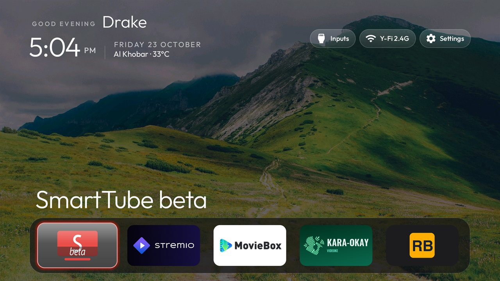
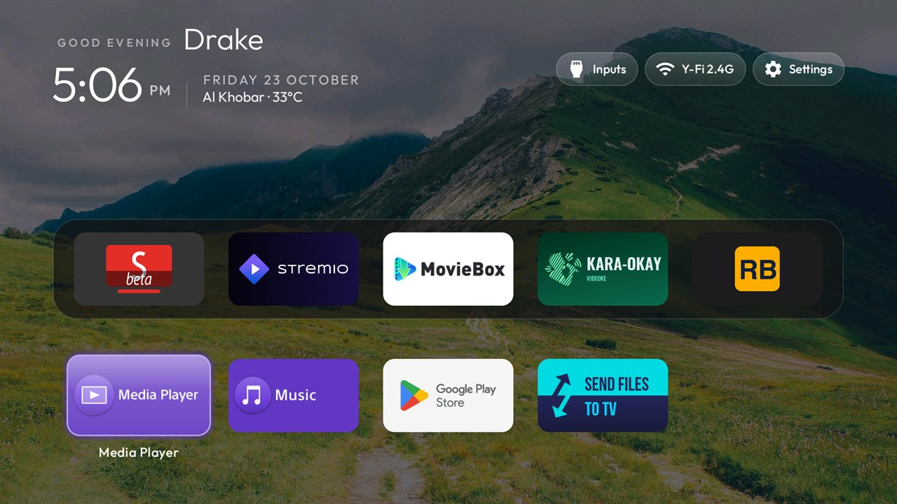
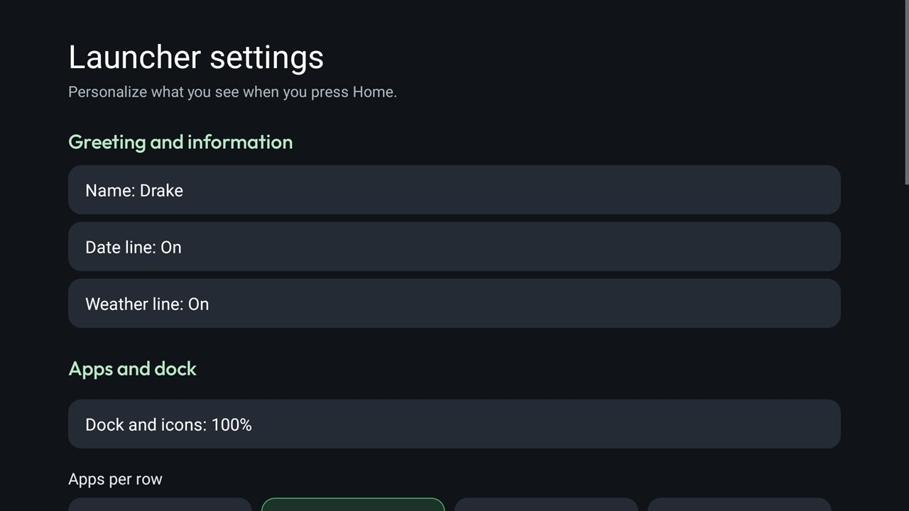

# Personal Home (Sony BRAVIA KD-65X85K / VH21)

A fork of the [CleanYourTV](https://github.com/Gathin23/cleanyourtv) launcher built and tested on a **Sony BRAVIA 4K VH21 (`KD-65X85K`), Android TV 12** (build `682241`).



## What it adds

- **Personal greeting & live weather header (`PersonalHeader.java`):**
  - Displays a customizable profile name next to the time-of-day greeting (`GOOD EVENING Drake`).
  - Displays the date line (`FRIDAY 23 OCTOBER`) and live local temperature (`Al Khobar · 33°C`) beside the clock.
  - Fetches current temperature from [Open-Meteo](https://open-meteo.com/) (`api.open-meteo.com`) at most once every 30 minutes and only while Home is visible.
- **Rotating online landscape wallpapers (`WallpaperPlayer.java`):**
  - When `"online_wallpaper": true` is set in `config.json`, rotates 1080p wallpapers from [Picsum Photos](https://picsum.photos/) (`picsum.photos/1920/1080`) on a configurable timer (15–240 minutes, default 60 minutes) while Home is visible, falling back to the local `wallpaper.jpg` offline.
- **Expanded on-TV Launcher Settings (`LauncherSettingsActivity.java`):**
  - **Greeting and information:** Toggle or edit `Name`, `Date line`, and `Weather line` directly with the TV remote.
  - **Apps and dock:** Adjust `Dock and icons` scale (`85%`, `100%`, `115%`) alongside `Apps per row`, `Rows below dock`, and `Dock band opacity`.
  - **Wallpaper:** Configure `Online wallpaper changes` interval (`15`, `30`, `60`, `120`, or `240` minutes).

## Screenshots

| Home (Dock Focus) | App Grid Below Dock | Launcher Settings |
|---|---|---|
|  |  |  |

## Theme Configuration (`config.json`)

```json
{
  "background_color": "#07080D",
  "wallpaper": true,
  "online_wallpaper": true,
  "personal_header": true,
  "greeting_name": "Drake",
  "ambient_glow": false,
  "dock_opacity": 70,
  "app_glow": true,
  "focus_overshoot": false,
  "app_keys": [
    "scan:485:org.smarttube.beta",
    "scan:583:com.stremio.one",
    "scan:494:okay.kara",
    "scan:490:com.community.mbox.tv"
  ],
  "hidden_apps": [
    "com.sony.dtv.tvx",
    "com.sony.dtv.notificationcenter",
    "com.sony.dtv.ecodashboard",
    "com.sony.dtv.smarthelp",
    "com.sony.dtv.livingfit",
    "com.google.android.play.games",
    "com.google.android.videos",
    "com.sony.dtv.timers"
  ]
}
```

## Privacy & Network Use

- **Network endpoints:** Only `https://api.open-meteo.com/v1/forecast` (when `personal_header` and the Weather line are enabled) and `https://picsum.photos/1920/1080` (when `online_wallpaper` is enabled).
- **No telemetry, analytics, or ads.** Requests run only while the Home screen is visible.
